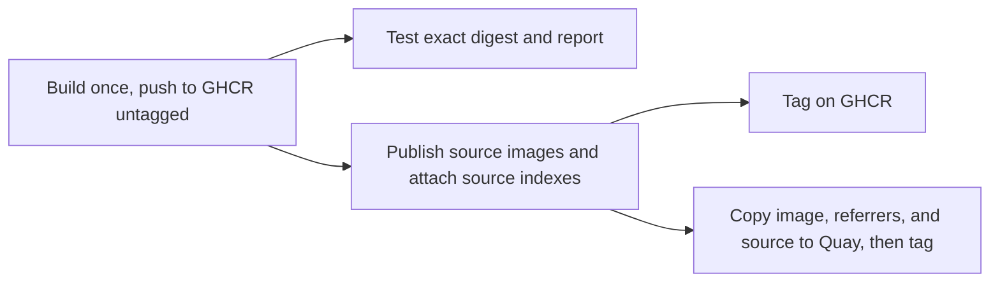

# Maintenance

## Dependabot

`.github/dependabot.yml` covers two ecosystems:

| Ecosystem | Directories | What it updates |
| --- | --- | --- |
| `docker` | `/`, `/sandboxes/*` | Every `FROM image:tag@sha256:digest` in the `Dockerfile` (base + all source stages), plus the kit Dockerfiles' reference to this image |
| `github-actions` | `/` | Actions in `.github/workflows/`, pinned by commit SHA |

Expectations:

- **Weekly schedule.**
- **Groups.** Lint tools are grouped (hadolint, shfmt, golangci-lint, betterleaks). Go, Node, and Python are kept **ungrouped**, so a language bump always gets its own reviewable PR. Pre-release tags (`-rc`, `a`/`b` releases) are ignored.
- **Major versions** of dependencies (Go and Python minor lines count as major here, as do Node major releases and Ubuntu LTS bases) get separate PRs and require a human merge. Patch and digest-only updates can be auto-merged once CI passes.

## Updates Dependabot can't handle

| Item | Mechanism |
| --- | --- |
| `gh` | Not pinned. The scheduled rebuild installs the latest `cli/cli` release, verified against its published checksums |
| git (PPA) | Not pinned. A scheduled weekly rebuild picks up new PPA releases |
| Ubuntu apt packages | Same as git: refreshed by the scheduled rebuild |
| Docker Engine packages | Same as git: refreshed from Docker's apt repository by the scheduled rebuild |
| `jv` (JSON Schema validator) | Pinned as a Go module version in the Dockerfile's `jv` stage (`go install ...@<version>`); bump it by hand |
| License files | Fetched from the installed version's upstream tag on every build, so nothing to track ([legal.md](legal.md#how-files-get-there)) |
| Claude Code, Codex | Not pinned by design. Scheduled builds refresh the installers; other builds may reuse cached installations. The agents can self-update at runtime |

## Build definitions

Both workflows build through **[`docker/github-builder`](https://github.com/docker/github-builder)'s reusable `bake.yml`**, pinned by commit SHA (Dependabot's `github-actions` ecosystem keeps it current). Targets come from `docker-bake.hcl`, so PR CI and publishing build exactly the same definitions.

`bake.yml` builds each platform on its own native runner (`ubuntu-26.04` and `ubuntu-26.04-arm`). It can't hand an image back to the calling workflow: `output` is either `image`, pushed to a registry, or `local`, a filesystem export. PR checks use the `preflight` target ([architecture.md](architecture.md#4-preflight-stage-preflight)). Publishing builds `image` once, then tests and copies that exact image by digest. Test results are reported independently of registry synchronization ([Publishing](#workflow)).

## CI (`ci.yml`, on every PR)

| Job | How | What |
| --- | --- | --- |
| `lint` | Plain job | `hadolint` on all Dockerfiles, `shfmt -d` on shell scripts, `actionlint` (if added), `betterleaks` over the repo |
| `preflight` | `bake.yml`, `target: preflight`, `output: local`, `cache: true` | Builds both architectures natively, runs the [preflight checks](#preflight-checks-testsmokesh) in the build, and exports each platform's `manifest.tsv` |
| `sources-plan` | Plain job, `needs: preflight` | Runs `scripts/plan-sources.sh --check` on the exported manifests: every root program that owes source must resolve to exact, available inputs. That catches missing upstream source on the PR itself |
| `runtime` | Plain job: `docker buildx bake image --load` (amd64) | Runs `test/runtime.sh` in a dedicated privileged DinD container with exclusive storage and no host socket mount; checks the daemon identity, then runs `hello-world`, a trivial build, and `docker compose version` |

The GitHub Actions `container:` check needs an image in a registry, so it runs in `publish.yml` against the GHCR digest alongside promotion to Quay. Ordinary container jobs use the runner's Docker daemon; dedicated DinD tests verify the server packaged in the image.

### Preflight checks (`test/smoke.sh`)

These run inside the PR `preflight` build and against the published image digest on both architectures, as both `agent` and root. Keep command lookup checks separate from environment configuration checks:

- **Commands and toolchains.** Runs under `env -i HOME="$HOME" PATH=/usr/local/sbin:/usr/local/bin:/usr/sbin:/usr/bin:/sbin:/bin`. Only the selected user's home and the default command path are passed through. It runs every tool's `--version` and fails if any tool is missing or can't execute. Pinned tools also fail on an unexpected version; unpinned tools (`gh`, git, and the agent CLIs) are checked for presence and execution. It runs as both `agent` and root, so the chained agent symlinks are verified for both. For Python, it also imports every stdlib module backed by a shared library (`ssl`, `ctypes`, `sqlite3`, `zlib`, `bz2`, `lzma`, `readline`, `curses`, `pyexpat`, `uuid`, `dbm.gnu`), which catches missing runtime libraries that `--version` would miss.
- **Image environment.** Preserve the image's `ENV` variables and reset only `PATH` to the default above. This suite must retain `pnpm_config_*`, `PNPM_HOME`, `GOPATH`, `BASH_ENV`, and locale settings. Check that `pnpm config get global-bin-dir` is `/usr/local/bin`, `pnpm config get prefer-offline` is `true`, and `pnpm store path` is under `/usr/local/share/pnpm` (as `agent`, as root, and with `HOME` set to an empty directory). Check that `agent` can `pnpm add -g` a small package whose bin resolves from `/usr/local/bin`, and that `uv python find` selects the image's Python without downloading anything. Run the shell and locale checks below in this environment too.
- **Sandbox contract and system setup:** `id agent` reports UID 1000 with home `/home/agent`, the default user is `agent`, `/bin/sh` and `/bin/bash` exist, `curl` and `git` are present, `BASH_ENV` resolves, `claude`/`codex` resolve on `PATH` in a non-interactive `bash -c`, `sudo --version` reports sudo-rs, `sudo -n true` succeeds as `agent` (passwordless), `visudo -c` passes, `sudo env` reports the caller's `PATH` unchanged (including a directory prepended at runtime) and keeps proxy variables, `agent` is in the `docker` and `staff` groups, `/go`, `/go/src`, and `/go/bin` are `root:staff` with mode `2775`, `go version` runs as both `agent` and root, `agent` can `go install` a module into `/go/bin`, `locale -a` lists `en_US.utf8`, and `locale` reports `LANG`/`LC_ALL` as `en_US.UTF-8` and `LANGUAGE` as `en_US:en` without warnings.
- **Attribution:** `/legal/LICENSE` matches the repository's root CC0 `LICENSE`. Every component, including the project's own installed files, base-image and apt packages, is recorded in the inventory with its required notices and source mapping; only the project's own files use its `CC0-1.0` designation (see [legal.md](legal.md#enforcement)).

## Publishing (`publish.yml`)

Images are published to two registries:

| Registry | Role |
| --- | --- |
| **`quay.io/frithuz/devcontainer`** | **Default distribution registry.** Receives the same image and artifacts from GHCR, independently of test results |
| **`ghcr.io/<owner>/devcontainer`** | **Build destination and public mirror.** `bake.yml` builds and pushes here first. Gives GitHub Actions consumers fast in-network pulls ([integrations/ghcr.md](integrations/ghcr.md)) |

Both carry the same tags, digests, signatures, source images, and source indexes. There are no versioned releases. Images are published continuously, and tags use only Docker-native forms:

| Tag | Published by | Meaning |
| --- | --- | --- |
| `:main` | Every push to `main` | Tip of `main`. Moves often |
| `:latest` | Every scheduled build | Most recent scheduled build. Moves on the schedule |
| `:YYYYMMDD` | Every scheduled build (UTC date of the original workflow run's creation) | Immutable snapshot; reruns keep the original date |

**No secrets are stored in GitHub.** GHCR is reached with GitHub's automatic `GITHUB_TOKEN`, and Quay with a short-lived token from OIDC robot federation.

### Workflow

`publish.yml` runs on pushes to `main` and on the weekly schedule. Runs and synchronization repairs share a concurrency group (`concurrency: publish`, never cancelling in-progress runs). Both registries are public. Tests report results while publication proceeds; a test failure does not prevent promotion or remove an image.

For scheduled runs, derive the snapshot date from the original workflow run's creation time and pass it explicitly to the metadata tag rules. Before `build` pushes anything, check that date tag in **both** registries. If it exists in either, refuse a fresh build for that date; resume attachment, verification, or promotion using the existing digest instead. Registry lookup errors must fail the check, not count as an absent tag. Recheck this guard when rerunning `build`.

Every later operation that applies a date tag must check its destination first: an absent tag may be created, the same digest is an idempotent success, and a different digest fails without overwriting it. This applies to retries and reruns too. Mutable `:main` and `:latest` tags retain their existing behavior.

| Job | How | What |
| --- | --- | --- |
| `build` | `bake.yml`, `target: image`, `output: image`, `push: true`, `cache: true`, explicit `cache-scope`, `sbom: true`, `meta-images: ghcr.io/<owner>/devcontainer`, `meta-tags` set to **only the recovery tag** (`build-<publication-id>`), `registry-auths` using `GITHUB_TOKEN` | Builds once, pushes, and signs on GHCR, **without public tags**. Records the index `digest` for downstream jobs and retries. Confirm during implementation that `bake.yml` signs and pushes with a single raw tag |
| `sources` | Plain job, `needs: build` | Derives the root programs that owe source from each platform's inventory, reuses existing `source-*` images, builds and pushes missing ones with the `source` bake target, and attaches one source index per subject on GHCR ([legal.md](legal.md#publishing)) |
| `tag-ghcr` | Plain job, `needs: [build, sources]` | Applies the public tags (rules above) to the GHCR digest (`oras tag`) |
| `verify` | Plain jobs, `needs: build` | Runs the complete smoke suite on both architectures as `agent` and root, a GitHub Actions `container:` check, and dedicated DinD checks against the published digest; reports failures |
| `promote` | Plain job, `needs: [build, sources]` | Copies the same digest to Quay with its referrers and source images, confirms them there, then applies the tags; has no dependency on `verify` |

`promote`, in order:

1. Log in to GHCR with `GITHUB_TOKEN` (`packages: read`) and to Quay with **robot federation** (`id-token: write`, see [integrations/quayio.md](integrations/quayio.md)).
2. Copy the index **by digest, untagged**, from GHCR to `quay.io/frithuz/devcontainer`, with its referrers (`oras cp -r`). That brings `bake.yml`'s signatures, the source indexes attached by `sources`, and the source images they list, skipping blobs Quay already has. Copying keeps digests, so signatures and attestations stay valid. Confirm the exact `oras cp` invocation for untagged, digest-only destinations during implementation.
3. Confirm on Quay that a source index is attached to the index and every platform manifest, through the native Referrers API, and that every source image it lists resolves. Also apply each source image's `source-*` tag on Quay, so source stays reachable and retained by tag.
4. Apply the public tags to the Quay digest (`oras tag`).

Quay protects an untagged digest-only push with a hidden temporary tag for **one hour** by default, so steps 2–4 must finish within that hour. `promote` only copies, checks, and tags, so it stays short.

- **Weekly refresh:** a scheduled build explicitly invalidates the apt, `gh`, and agent installation layers, using a refresh build argument consumed before those instructions. Its value is stable within a run and changes for each new scheduled run. Merely rebuilding or pulling the pinned base digest does not refresh cached `RUN` instructions. Other builds may reuse installation layers. Refresh existing installed apt packages as well as newly installed packages, so base-image packages receive available updates.
- **Unchanged components:** use independent `COPY --link` layers for pinned standalone tools, and per-root [source images](legal.md#source-images) keyed by exact version. Weekly refreshes do not invalidate either merely because the date changed. Every image gets its own source indexes, but unchanged source images are reused across releases and copied to the other registry only when absent.
- **Image identity:** downstream jobs pull the recorded digest. They never rebuild `image` or use a mutable tag to select what to test, attach to, or copy. The PR `preflight` target is not part of the publish path.
- **Test failures:** preserve failing job results and logs, report the affected digest, and open or update an issue. Promotion continues independently; neither registry rolls back or deletes the image because a test failed.
- **Synchronization failures:** retry source publication and copying against the recorded digest, then alert on unresolved failures. An incomplete sync is a publication failure even when tests pass. Repair missing tags and artifacts without rebuilding or deleting shared manifests; see [GHCR recovery](integrations/ghcr.md#synchronization-and-recovery).

### Registry and signing

- **GHCR:** `ghcr.io/<owner>/devcontainer`, a **public** package linked to this repository. Publishing needs write access; grant the **Admin** Actions role only when retention deletion is implemented. `bake.yml` pushes with `registry-auths` built from `${{ github.actor }}` and `${{ secrets.GITHUB_TOKEN }}`. That's GitHub's automatic per-run token, not a stored secret. Setup is in [integrations/ghcr.md](integrations/ghcr.md).
- **Quay:** one robot account, `frithuz+promote`, with **Write** on `devcontainer` only. Its only login method is **robot federation**: the robot trusts GitHub's OIDC issuer for this repository's `main` ref, and `promote` exchanges its GitHub OIDC token for a one-hour Quay token. No token is stored. Setup is in [integrations/quayio.md](integrations/quayio.md).
- **Other secrets:** none are needed today. If a job of ours ever needs a credential for a service without OIDC federation, it comes from 1Password through **Workload Identity**, never from a GitHub secret. See [integrations/1password.md](integrations/1password.md) for the setup and its one bootstrap exception.
- **Visibility:** create `frithuz/devcontainer` on Quay as a public repository before the first promote. Quay makes repositories private when a push creates them ([integrations/quayio.md](integrations/quayio.md#2-repository-frithuzdevcontainer)).
- **Attestations:** `bake.yml` attaches SBOM (`sbom: true`) and SLSA provenance. Provenance is `mode=max` automatically, because the source repository is public.
- **Signing:** `bake.yml` signs the per-platform attestation manifests keylessly with cosign, on GHCR. There they're stored through the referrers tag fallback. `promote` copies them to Quay with the image, where they're native referrers. The signing identity is `bake.yml` itself, so verification works the same against either registry. `bake.yml`'s `cosign-verify-commands` output names GHCR, and the workflow summary adds the Quay equivalents.

### Tags and schedule

- **Schedule:** weekly, with explicit installation-cache invalidation as described above. Each scheduled run builds one refreshed image; tests and registry synchronization use that same digest in parallel.
- **Consumers** should pin `:YYYYMMDD@sha256:<digest>`. Date tags sort as versions, so the consumer's Dependabot proposes newer snapshots. `:latest@sha256:<digest>` also works, but Dependabot can then only bump the digest. Which registry to use is in [usage.md](usage.md#which-registry).
- Only the image is published. Sandbox kits are consumed from git at a commit, not pushed to a registry ([usage.md](usage.md#agent-sandboxes-sbx)).
- Completed publications include matching copyleft source in both registries. Public tags are applied in each registry only after its source images and source indexes are present ([legal.md](legal.md#publishing)).
- **Retention:** no automatic expiry, pruning, or age/count limit currently applies. Keep snapshots, source images and indexes, publication records, and their evidence in both registries. A future deletion policy is undecided and must follow the [legal retention rules](legal.md#retention). Durable publication data lives in registry artifacts; the [data model draft](data-model.md) defines the proposed records and recovery links.

## Contributor expectations

- **Project license.** Original contributions are accepted under [CC0-1.0](../LICENSE). Contribute only work you have authority to dedicate; identify imported third-party material and preserve its license and notices. See [license scope and impacts](legal.md#project-license).
- **Adding a tool.** If an upstream image with a static binary or glibc-compatible binary exists, add a pinned `FROM` source stage and a `COPY`. Otherwise, justify the scripted install in the PR and add it to [tooling.md](tooling.md). Either way, make sure its command resolves under the default `PATH` (copy into `/usr/local/bin` or add a symlink there), and add it to `test/smoke.sh`, the [tooling.md](tooling.md) inventory, and `scripts/legal-components.yaml` with its license files' source ([legal.md](legal.md#how-files-get-there)).
- Never add an unpinned `FROM` or an unchecked download. `curl | sh` is allowed only for the documented agent standalone installers.
- Keep the final stage free of build-only tooling. Fetching belongs in builder stages.
- Don't break the [sandbox contract](architecture.md#docker-sandboxes-contract). User, UID, home, and shell requirements are fixed.
