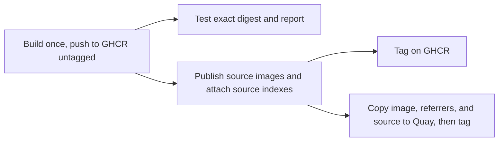

# Maintenance

> Planned: Dependabot, `ci.yml`, and `test/` don't exist yet. `publish.yml` so far only builds, pushes to GHCR under the recovery tag `build-<run id>`, and publishes the source images: source indexes, public tags, `verify`, and `promote` are still to come. This page describes the intended design.

## Dependabot

Dependabot runs weekly on two ecosystems: `docker`, for every pinned `FROM` (plus the kits' reference to this image), and `github-actions`, for actions pinned by commit SHA.

- Lint tools are grouped into one PR. Go, Node, and Python stay **ungrouped**, so each language bump gets its own reviewable PR.
- Go and Python minor lines, Node majors, and Ubuntu LTS bases count as major updates. They get separate PRs and need a human merge. Patch and digest-only updates can auto-merge once CI passes. Pre-release tags are ignored.

## Updates Dependabot can't handle

- **apt packages** (base, git PPA, Docker Engine), **`gh`**, and the **agent CLIs** aren't pinned. The weekly build's refresh argument reinstalls them ([architecture.md](architecture.md#dockerfile-structure)). Other builds may reuse cached layers, so a push build can be up to a week behind on these.
- **`jv`** is pinned as a Go module version in its builder stage and bumped by hand.
- **License files** are fetched from the installed version's upstream tag on every build, so there's nothing to track. When a tool is bumped, review its `SOURCE` checksums for a license change ([legal.md](legal.md#how-files-get-there)).

## Build definitions

Both workflows build through [`docker/github-builder`](https://github.com/docker/github-builder)'s reusable `bake.yml`, with targets from `docker-bake.hcl`, so PR CI, publishing, and local builds use the same definitions. Each platform builds on its own native runner.

`bake.yml` can't hand an image back to the calling workflow: it either pushes to a registry or exports files. That's why PR checks run *inside* the build (the `preflight` target, which exports its results), and why publishing pushes once and has every later job pull that digest.

## CI (`ci.yml`, on every PR)

`lint.yml` runs [actionlint](https://github.com/rhysd/actionlint) and [zizmor](https://docs.zizmor.sh/) over the workflows on every PR and push to `main`, zizmor at the `auditor` persona. They run as background steps of one job, so both always run, and any finding from either fails it. actionlint's `.github/actionlint.yaml` lists runner labels newer than its built-in list, and ignores its errors on background steps in `lint.yml` until it supports them. For zizmor, every write permission needs a comment saying why it's there and every job needs a `name`.

- **lint:** hadolint, shfmt, and betterleaks over the repository.
- **preflight:** builds both architectures and runs the smoke tests inside the build.
- **sources-plan:** runs `scripts/plan-sources.sh --check` on the exported manifests, so a copyleft component whose exact source can't be resolved fails the PR instead of the publish.
- **runtime:** DinD checks in a dedicated privileged container with no host socket ([architecture.md](architecture.md#docker)).

The GitHub Actions `container:` check needs an image in a registry, so it runs in `publish.yml` against the pushed digest.

### Preflight checks (`test/smoke.sh`)

The smoke tests run in the PR build and against the published digest, on both architectures, as both `agent` and root. They're split in two because they test different things:

- **Command lookup** runs under `env -i` with only `HOME` and the default `PATH`, the way GitHub Actions sees the image. Every tool must run. Pinned tools must also report their expected version, while unpinned ones only need to be present. Running as root as well verifies the chained agent symlinks. Python also imports every stdlib module that's backed by a shared library.
- **Image environment** keeps the image's `ENV` and resets only `PATH`. It checks that the pnpm configuration applies as `agent`, as root, and with an empty `HOME`, that `agent` can write to the shared install targets, that the sandbox contract and sudo behavior hold, and that the locale is set without warnings.

## Publishing (`publish.yml`)

The image goes to two public registries with the same tags, digests, signatures, and source:

- **`quay.io/frithuz/devcontainer`**, the default distribution registry.
- **`ghcr.io/<owner>/devcontainer`**, the build destination and mirror. `bake.yml` can push there with the automatic `GITHUB_TOKEN`, and Actions consumers get in-network pulls ([integrations/ghcr.md](integrations/ghcr.md)).

There are no versioned releases:

| Tag | Published by | Meaning |
| --- | --- | --- |
| `:main` | Every push to `main` | Tip of `main`. Moves often |
| `:latest` | Every scheduled build | Most recent scheduled build |
| `:YYYYMMDD` | Every scheduled build | Immutable snapshot, dated by the original run's creation, so reruns keep the date |

**No secrets are stored in GitHub.** GHCR uses `GITHUB_TOKEN`, and Quay uses OIDC robot federation.

### Workflow

`publish.yml` runs on pushes to `main` and weekly. Runs and repairs share one concurrency group that never cancels a run in progress.

The rules behind that shape:

- **Build once.** Every later job pulls the recorded digest. None of them rebuilds or selects an image by a mutable tag.
- **Source before tags.** Copyleft obligations require the source in the same repository as the image, so no public tag is applied in a registry until that registry has the image's source ([legal.md](legal.md#publishing)).
- **Tests report, they don't gate.** A failing test is reported and opens an issue, but it doesn't block promotion or remove an image. Synchronization failures are separate. They're retried against the recorded digest, and an incomplete sync is a publication failure even when tests pass.
- **Date tags are never overwritten.** Before building, check the date tag in both registries. If it exists, resume the existing publication instead of building again. Wherever a date tag is applied, an existing tag with the same digest is success, and a different digest is a conflict. Registry lookup errors fail the check rather than counting as an absent tag.
- **Quay's one-hour window.** Quay protects an untagged, digest-only push with a hidden temporary tag for one hour. `promote` has to copy, confirm, and tag within that hour, so it only copies, checks, and tags. That hour also matches the federated Quay token's lifetime.

Recovery of an interrupted publication is described in [integrations/ghcr.md](integrations/ghcr.md#synchronization-and-recovery) and the [data model draft](data-model.md).

### Registry and signing

- **GHCR** is a public package linked to this repository, written with `GITHUB_TOKEN`. Grant the Admin Actions role only once retention deletion exists ([integrations/ghcr.md](integrations/ghcr.md)).
- **Quay** has one robot, `frithuz+promote`, with Write on `devcontainer` only, logging in exclusively through federation pinned to `main` ([integrations/quayio.md](integrations/quayio.md)). Create the repository as public before the first promote. A push that creates the repository creates it private.
- **Other credentials**, if ever needed, come from 1Password Workload Identity, never GitHub secrets ([integrations/1password.md](integrations/1password.md)).
- **Attestations and signing:** `bake.yml` attaches an SBOM and SLSA provenance and signs keylessly with cosign on GHCR. `promote` copies the signatures to Quay with the image. The signing identity is `bake.yml` itself, so verification works the same against either registry.

### Tags and schedule

- **Consumers** should pin `:YYYYMMDD@sha256:<digest>`. Date tags sort as versions, so the consumer's Dependabot proposes newer snapshots. With `:latest`, it can only bump the digest.
- Only the image is published. Sandbox kits are consumed from git ([usage.md](usage.md#agent-sandboxes-sbx)).
- **Retention:** nothing expires today. Any future deletion policy must follow the [legal retention rules](legal.md#retention).

## Contributor expectations

- **License.** Contributions are accepted under [CC0-1.0](../LICENSE). Contribute only work you can dedicate, and keep imported third-party material under its own license ([legal.md](legal.md#project-license)).
- **Adding a tool.** Prefer a pinned upstream image with a static or glibc-compatible binary. Justify any scripted install in the PR. Either way, make its command resolve under the default `PATH`, and add it to the smoke tests and to `scripts/legal-components.yaml` in the same PR. The build fails on an ELF file it can't attribute.
- Never add an unpinned `FROM` or an unchecked download. `curl | sh` is allowed only for the agent installers.
- Keep build-only tooling out of the final stage. Fetching belongs in builder stages.
- Don't break the [sandbox contract](architecture.md#docker-sandboxes-contract).
