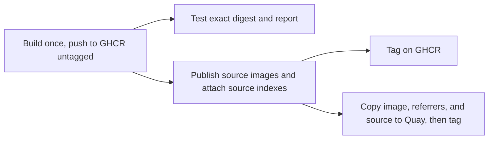

# Maintenance

> Planned: `ci.yml` and `test/` don't exist yet, and Dependabot covers only the `docker` ecosystem so far. `publish.yml` so far only builds, pushes to GHCR under the recovery tag `build-<run id>` (also `latest` on pushes to `main`, and optionally on manual runs), publishes the source images and attaches the source indexes, and, only on runs that tag `latest`, promotes the image with its source to Quay under the same tags: automatic public tags and `verify` are still to come. This page describes the intended design.

## Dependabot

Dependabot runs weekly on two ecosystems: `docker`, for every pinned `FROM` in `Dockerfile` and `source.Dockerfile`, and `github-actions`, for actions pinned by commit SHA. Both wait out a 3-day cooldown after a release before proposing it. The kits' reference to this image is left to `kits.yml` ([sandbox kits](#sandbox-kits)), because a bump must rewrite each kit's `provides` with it.

- Lint tools are grouped into one PR. Go, Node, and Python stay **ungrouped**, so each language bump gets its own reviewable PR.
- Go and Python minor lines, Node majors, and Ubuntu LTS bases count as major updates. They get separate PRs and need a human merge. Patch and digest-only updates can auto-merge once CI passes. Pre-release tags are ignored.

## Updates Dependabot can't handle

- **apt packages** (base, git PPA, Docker Engine), **`gh`**, and the **agent CLIs** aren't pinned. The weekly build's refresh argument reinstalls them ([architecture.md](architecture.md#dockerfile-structure)). Other builds may reuse cached layers, so a push build can be up to a week behind on these.
- **`jv` and `task`** are pinned as Go module versions in their builder stages and bumped by hand.
- **License files** are fetched from the installed version's upstream tag on every build, so there's nothing to track. When a tool is bumped, review its `SOURCE` checksums for a license change ([legal.md](legal.md#how-files-get-there)).

## Build definitions

Both workflows build through [`docker/github-builder`](https://github.com/docker/github-builder)'s reusable `bake.yml`, with targets from `docker-bake.hcl`, so PR CI, publishing, and local builds use the same definitions. Each platform builds on its own native runner.

`bake.yml` can't hand an image back to the calling workflow: it either pushes to a registry or exports files. That's why PR checks run *inside* the build (the `preflight` target, which exports its results), and why publishing pushes once and has every later job pull that digest.

## CI (`ci.yml`, on every PR)

`lint.yml` runs [actionlint](https://github.com/rhysd/actionlint) and [zizmor](https://docs.zizmor.sh/) over the workflows on every PR and push to `main`, zizmor at the `auditor` persona. They run as background steps of one job, so both always run, and any finding from either fails it. actionlint's `.github/actionlint.yaml` lists runner labels newer than its built-in list, and ignores its errors on background steps in `lint.yml` until it supports them. For zizmor, every write permission needs a comment saying why it's there and every job needs a `name`.

- **lint:** hadolint, shfmt, and betterleaks over the repository.
- **preflight:** builds both architectures and runs the smoke tests inside the build.
- **sources-plan:** runs `scripts/plan-sources.sh --check` on the exported manifests, so a copyleft component whose exact source can't be resolved fails the PR instead of the publish.
- **runtime:** DinD checks in a dedicated privileged container with no host socket ([architecture.md](architecture.md#docker)).

The GitHub Actions `container:` check needs an image in a registry, so it runs in `publish.yml` against the pushed digest.

### Preflight checks (`test/smoke.sh`)

The smoke tests run in the PR build and against the published digest, on both architectures, as both `agent` and root. They're split in two because they test different things:

- **Command lookup** runs under `env -i` with only `HOME` and the default `PATH`, the way GitHub Actions sees the image. Every tool must run. Pinned tools must also report their expected version, while unpinned ones only need to be present. Running as root as well verifies the chained agent symlinks. Python also imports every stdlib module that's backed by a shared library.
- **Image environment** keeps the image's `ENV` and resets only `PATH`. It checks that the pnpm configuration applies as `agent`, as root, and with an empty `HOME`, that `agent` can write to the shared install targets, that the sandbox contract and sudo behavior hold, and that the locale is set without warnings.

## Publishing (`publish.yml`)

A run publishes only a [material change](#material-changes) from Quay's `latest`. Every push to `main` starts a run, and one that doesn't touch the build's inputs, such as docs or kits alone, stops after the comparison. Pushes and scheduled refreshes that publish tag `latest`. For a manual run, select **Run workflow** and enable **Also tag the built image as latest, and promote it to Quay** (`latest`, off by default), and **force** to publish without a material change. A run that tags `latest` pushes both `build-<run id>` and `latest` to the same image digest, and `promote` copies the image to Quay with both tags. Manual runs without `latest` stay on GHCR. On GHCR the `latest` tag is applied during the build, before source publication, so it can move even if the later source job fails. On Quay it's applied only after the source indexes and their source images are copied and checked. The `refresh` input remains independent.

The image goes to two public registries with the same tags, digests, signatures, and source:

- **`quay.io/frithuz/devcontainer`**, the default distribution registry.
- **`ghcr.io/<owner>/devcontainer`**, the build destination and mirror. `bake.yml` can push there with the automatic `GITHUB_TOKEN`, and Actions consumers get in-network pulls ([integrations/ghcr.md](integrations/ghcr.md)).

There are no versioned releases:

| Tag | Published by | Meaning |
| --- | --- | --- |
| `:main` | Every push to `main` that touches the build's inputs | Latest build of `main`. Moves often |
| `:latest` | Every scheduled build | Most recent scheduled build |
| `:YYYYMMDD` | Every scheduled build | Immutable snapshot, dated by the original run's creation, so reruns keep the date |

**No secrets are stored in GitHub.** GHCR uses `GITHUB_TOKEN`, and Quay uses OIDC robot federation.

### Workflow

`publish.yml` runs on pushes to `main` and weekly. Runs and repairs share one concurrency group that never cancels a run in progress.



The rules behind that shape:

- **Build once.** Every later job pulls the recorded digest. None of them rebuilds or selects an image by a mutable tag.
- **Source before tags.** Copyleft obligations require the source in the same repository as the image, so no public tag is applied in a registry until that registry has the image's source ([legal.md](legal.md#publishing)).
- **Tests report, they don't gate.** A failing test is reported and opens an issue, but it doesn't block promotion or remove an image. Synchronization failures are separate. They're retried against the recorded digest, and an incomplete sync is a publication failure even when tests pass.
- **Date tags are never overwritten.** Before building, check the date tag in both registries. If it exists, resume the existing publication instead of building again. Wherever a date tag is applied, an existing tag with the same digest is success, and a different digest is a conflict. Registry lookup errors fail the check rather than counting as an absent tag.
- **Quay's one-hour window.** Quay protects an untagged, digest-only push with a hidden temporary tag for one hour. `promote` has to copy, confirm, and tag within that hour, so it only copies, checks, and tags. That hour also matches the federated Quay token's lifetime.

### Material changes

Rebuilding the same commit doesn't reproduce the same digest. A refresh reruns every `RUN` step, and timestamps, logs, and caches change most layers even when nothing installed changed. Run 40313178179, a refresh of the commit run 40265483889 built, changed 38 of 42 arm64 layers, with an identical config and an identical inventory. So `publish.yml` compares what the image is made of instead, against Quay's `latest`, before anything is pushed:

1. **Build inputs.** The `changes` job diffs this commit against the one `latest` was built from (its index's `org.opencontainers.image.revision`), over the files that reach the image or its source images: everything `.dockerignore` admits to the build context, `.dockerignore` itself, `docker-bake.hcl`, and `publish.yml`, which sets the image's annotations. That covers the Dockerfile's logic, `rootfs/`, the scripts, and the base image pin. The scripts that only compare or copy manifests, or point the kits at an image, are left out.
2. **Inventory.** Unchanged inputs can still produce a different image when a refresh installs newer apt packages or agents. On a refresh, `preflight` builds the `preflight` target, which pushes nothing and exports each platform's `/legal/manifest.tsv`. `inventory` compares it with `latest`'s, ignoring the project row's revision. Every installed apt package is a row with its version and `.deb` SHA512, and the agents' rows carry their binary checksums.

| Inputs | Run | Result |
| --- | --- | --- |
| Changed, or **force** (which skips the comparison, so it also works with no `latest` in Quay) | Any | Build and publish |
| Unchanged | Refresh | Build and publish only if the inventory changed |
| Unchanged | Any other | Nothing is built or pushed |

`scripts/image-changes.sh` does both comparisons and prints what differs, and each job's summary shows the decision. When the inventory changed, `build` reuses `preflight`'s cache: both use the `image` cache scope and the same vars, so the refreshed layers aren't rebuilt. It still builds and pushes `image` itself, so the published image never takes its identity from preflight. The list of build inputs exists only there, derived from `.dockerignore`, so admitting a new path to the build context also makes it an input. `scripts/copy-manifests.sh` copies each platform's `/legal/manifest.tsv` out of a registry image, for the comparison, for source planning, and for `update-kits.sh`.

Recovery of an interrupted publication is described in [integrations/ghcr.md](integrations/ghcr.md#synchronization-and-recovery) and the [data model draft](data-model.md).

### Registry and signing

- **GHCR** is a public package linked to this repository, written with `GITHUB_TOKEN`. Grant the Admin Actions role only once retention deletion exists ([integrations/ghcr.md](integrations/ghcr.md)).
- **Quay** has one robot, `frithuz+promote`, with Write on `devcontainer` only, logging in exclusively through federation pinned to the `quay` environment, which only `main` can deploy to ([integrations/quayio.md](integrations/quayio.md)). Create the repository as public before the first promote. A push that creates the repository creates it private.
- **Other credentials**, if ever needed, come from 1Password Workload Identity, never GitHub secrets ([integrations/1password.md](integrations/1password.md)).
- **Attestations and signing:** `bake.yml` attaches an SBOM and SLSA provenance and signs keylessly with cosign on GHCR. `promote` copies the signatures to Quay with the image. The signing identity is `bake.yml` itself, so verification works the same against either registry.

### Tags and schedule

- **Consumers** should pin `:YYYYMMDD@sha256:<digest>`. Date tags sort as versions, so the consumer's Dependabot proposes newer snapshots. With `:latest`, it can only bump the digest.
- Only the image is published. Sandbox kits are consumed from git ([usage.md](usage.md#agent-sandboxes-sbx)).
- **Retention:** nothing expires today. Any future deletion policy must follow the [legal retention rules](legal.md#retention).

### Sandbox kits

Each kit pins the image in its dockerfile's `FROM` and states the agent version that image installed in its descriptor's `provides` (`claude@2.1.310`). The agent can still update itself inside a sandbox, so `provides` records what the image shipped, not what's running.

The versions come from `/legal/manifest.tsv`, which every build writes for each platform. They can also be read from the registry without pulling the image, through the SBOM attestation (the `claude-code` and `codex` packages):

```sh
docker buildx imagetools inspect quay.io/frithuz/devcontainer:latest --format '{{json .SBOM}}'
```

`scripts/update-kits.sh <name>:<tag>@sha256:<digest>` copies both platforms' manifests out of an image and fails unless each agent has one version across them. It then rewrites every kit's `FROM` and `provides` together. Run it by hand to point the kits at any published image.

`kits.yml` runs the script, and it starts two ways. `publish.yml` calls it after a promotion that tags `latest` in Quay, with that image. `promote` reports `latest` only after `oras tag` has applied it, so a run that promotes without `latest` leaves the kits alone. To point the kits at another image already in Quay, run **kits** by hand with its `quay.io/frithuz/devcontainer:<tag>@sha256:<digest>` reference.

If anything changed, it builds the kits with the kit frontend, which validates each descriptor and runs the conformance checks. It then force-pushes one commit to `kits/update` and opens or updates that branch's PR. Runs take turns on that branch. Review and merge the PR like any other.

- A weekly refresh reaches the kits when it publishes: when its inventory changed, or when the build inputs changed since `latest`, for example after a push whose publication failed.
- A PR opened with `GITHUB_TOKEN` doesn't trigger other workflows, so `lint.yml` doesn't run on it. The kits build in `kits.yml` is its check.
- Enable **Settings → Actions → General → Allow GitHub Actions to create and approve pull requests**, or `gh pr create` fails.
- The kits aren't build inputs, so merging a kits PR starts a `publish` run that stops after the comparison. Otherwise it would publish a new image, which would open the next kits PR.

## Contributor setup

From the repository root, run `task repo:init` with Task 3.54.0 or newer.
Task is included in the devcontainer image.
Alternatively, run `sh tools/repo-init.sh` directly without Task. Setup checks
prerequisites and sets repository-local `core.hooksPath` to `.githooks`; it is
safe to repeat and does not install tools or change global Git configuration.
It warns before replacing a different hook directory for this checkout.

The [commit-msg hook](../.githooks/commit-msg), its tests, and setup are copied
from [frithuz/mdchk](https://github.com/frithuz/mdchk/tree/3cacdd9f70cfba8de46baddd4e35382f081e5adc/.githooks).
On normal and amended commits, the hook removes all case variants of
`Co-Authored-By:` trailers and their continuation lines. Git's trailer parser
distinguishes these from subject and body text; unrelated trailers and other
message bytes are preserved. A parsing or write failure rejects the commit.

The hook requires POSIX `sh`, Git 2.22 or newer, and standard macOS/Linux Unix
utilities. To run its integration tests with Bats 1.7 or newer:

```sh
bats .githooks/commit-msg.bats
```

Activation must be repeated for each clone. This is local enforcement:
`--no-verify` and commands that do not invoke `commit-msg` can bypass it.
The no-co-author rule in [AGENTS.md](../AGENTS.md) still applies.

## Contributor expectations

- **License.** Contributions are accepted under [CC0-1.0](../LICENSE). Contribute only work you can dedicate, and keep imported third-party material under its own license ([legal.md](legal.md#project-license)).
- **Adding a tool.** Prefer a pinned upstream image with a static or glibc-compatible binary. Justify any scripted install in the PR. Either way, make its command resolve under the default `PATH`, and add it to the smoke tests and to `scripts/legal-components.yaml` in the same PR. The build fails on an ELF file it can't attribute.
- Never add an unpinned `FROM` or an unchecked download. `curl | sh` is allowed only for the agent installers.
- Keep build-only tooling out of the final stage. Fetching belongs in builder stages.
- Don't break the [sandbox contract](architecture.md#docker-sandboxes-contract).
